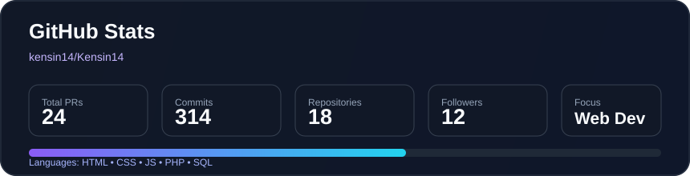
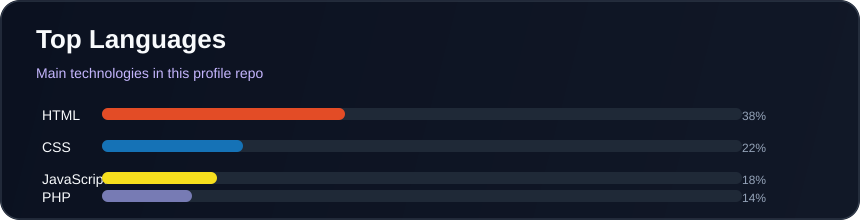

<h1 align="center">👋 Hi, I'm Nanang Hardita</h1>

<h3 align="center">
  💻 Web Developer | Pacitan, East Java, Indonesia
</h3>

  

---

## 🚀 About Me

- 👨‍💻 My name is Nanang Hardita.
- 🌍 Based in Pacitan, East Java, Indonesia.
- 💻 Interested in Web Development.
- 🌱 Learning and improving my programming skills.
- 🎯 Focused on building modern and responsive websites.

---

## 🛠️ Tech Stack

  

---

## 📊 GitHub Statistics

  
  

---

## 📈 Contribution Activity

  

---

## 🌐 Find Me Online

  

---

<h3 align="center">✨ Keep Learning, Keep Building!</h3>

  Thanks for visiting my GitHub profile!

  

